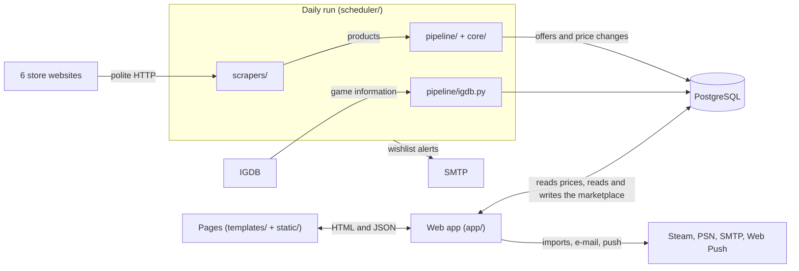

# Architecture

The daily run reads the stores and writes the prices. The web app reads them, and writes only what people do on the site. The two never call each other: PostgreSQL sits between them.

## The parts

| Part | Where | Job | Start reading at |
|---|---|---|---|
| Daily run | `scheduler/`, `scrapers/`, `pipeline/`, `core/` | Read the stores, match each offer to a game and edition, record price changes, fetch game information | `scheduler/run_all_scrapers.py` |
| Database | `database/`, `migrations/`, `app/models.py`, `db.py` | The price side and the marketplace side (see [Data](#data)) | `database/setup.py` |
| Web app | `app/web.py`, `app/routes/`, `app/services/` | Pages and the JSON API: one blueprint per area, one service per area | `app/web.py` |
| Pages | `templates/`, `static/` | One template and one script per page, shared scripts, the installable app | `static/common.js` |
| Tests | `tests/` | pytest; database tests get a throwaway database | `tests/conftest.py` |
| Running it | `Dockerfile`, `docker-compose.yml`, `docker-compose.production.yml`, `docker/` | Containers on a PC or on the server | [DEPLOY.md](../DEPLOY.md) |

## The daily run

1. **Start.** On the PC, a Windows task (`scheduler/register_daily_task.ps1`) runs `--due` at logon and every 2 hours: a full run when none happened in 20 hours, otherwise a light run. On the server, `scheduler/daemon.py` starts the full run at 06:00 and the light run at 18:00, Lisbon time, each as its own process.
2. **Each store, one at a time.** A blocked store waits 24 hours, and a store read successfully less than 8 hours ago is skipped. The scraper reads the store through its polite HTTP client. A run that finds fewer than 70% of the products of the last one saves the prices, deactivates nothing and ends as a warning. The products are then saved in one transaction: duplicates and codes in a box are dropped, each offer is matched, and a price-history row is added only when the price or stock changed. One store failing doesn't stop the others.
3. **After the stores.** IGDB game information (full run only), the cards, purchases sent 7 days ago are completed, the wishlist alerts (full run only), and a notice when a store failed: a Windows notification on the PC, an e-mail on the server. Each step is skipped on an error without stopping the rest.

Details: [Daily update](../README.md#daily-update), [Not getting blocked by the stores](../README.md#not-getting-blocked-by-the-stores), [Safeguard against a half-broken scraper](../README.md#safeguard-against-a-half-broken-scraper), [Games and editions](../README.md#games-and-editions).

## A request

1. A page script calls `api()` from `static/common.js`, which adds the `X-Requested-With: fetch` header and sends the login cookie.
2. Guards in `app/web.py`: a JSON body over 1 MB is refused, a change without the header gets 403, and a JSON body must be an object.
3. A blueprint in `app/routes/` reads the parameters, checks the login and calls one service.
4. The service in `app/services/` applies the rules and reads or writes through `db.py`. A refusal raises the service's own error, which the blueprint returns as `{"error": code}`.
5. Every answer carries the security headers, including a Content-Security-Policy that runs scripts only from files.

## Data

| | Price side | Marketplace side |
|---|---|---|
| Defined in | `database/schema.sql`, `database/indexes.sql`, `database/views.sql`, `database/seed_stores.sql` | `app/models.py`, with Alembic revisions in `migrations/versions/` |
| Written by | The daily run | People, through the web app |
| Holds | Platforms, stores, games, editions, offers, price history, scrape runs, merged ids; the `current_offers` view decides real discounts | Users, listings, conversations, messages, ratings, collections and wishes, reviews, follows, reports, pinned matches and more (`MARKET_TABLES` in `app/models.py`) |
| Changed by | An `ALTER TABLE … ADD COLUMN IF NOT EXISTS` in `database/schema.sql` | A new Alembic revision |

The two sides meet where people point at the catalogue: listings, collection items and reviews refer to games and editions, and pinned matches refer to offers. `python -m database.setup` builds both.

## Where it runs

| | On the PC | On the server |
|---|---|---|
| Web app | `python app.py` on port 5000, restarting when a `.py` file changes | waitress behind Caddy, which serves HTTPS |
| Daily run | The Windows task | `scheduler/daemon.py` in its own container |
| Problems reported by | A Windows notification | An e-mail to `ALERT_EMAIL` |
| Backups | None | Every night at 03:30: database dumps kept 14 days, photo archives kept 3 |

## Outside services

| Service | Used for | Code |
|---|---|---|
| IGDB | Game information, the sell form's search for games no store sells | `pipeline/igdb.py`, `app/services/igdb_game_service.py` |
| Steam Web API | Importing a user's Steam games | `app/services/steam_service.py` |
| PSN (unofficial API) | Importing a user's PlayStation games and trophies | `app/services/psn_service.py` |
| SMTP | Password resets, wishlist alerts, run alerts | `app/services/mail_service.py` |
| Web Push | Notifications on phones and computers | `app/services/push_service.py` |
